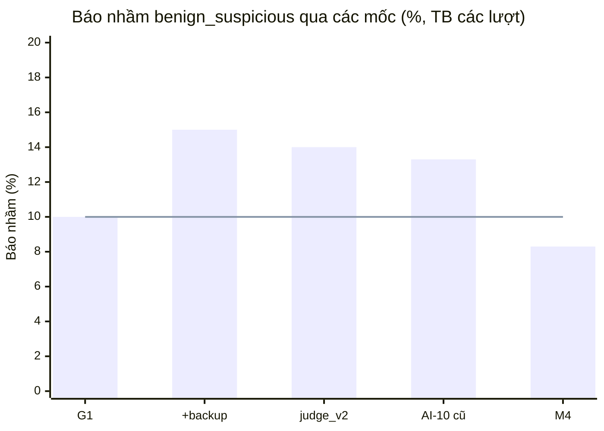
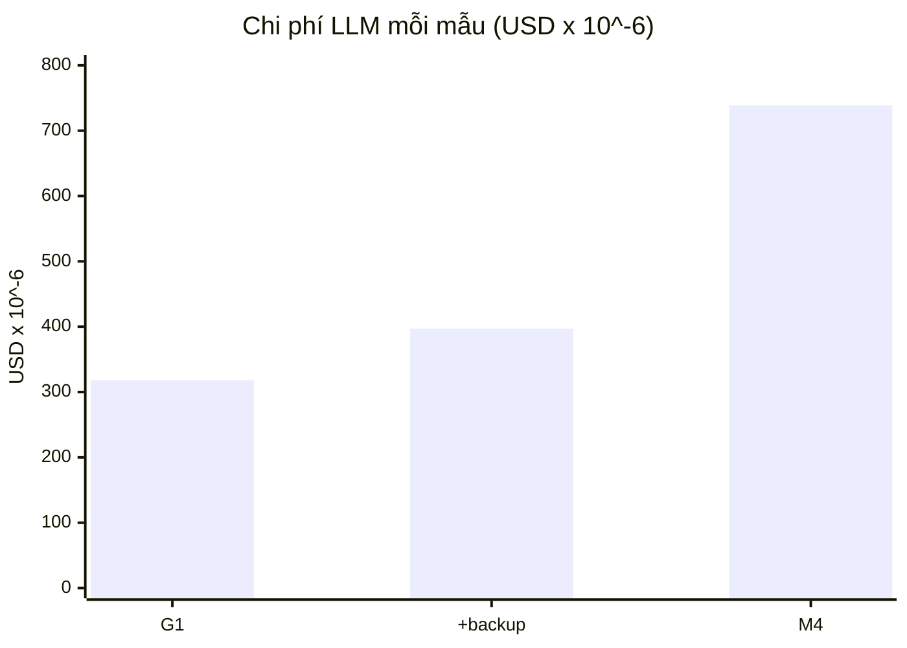

# Báo cáo eval Gate M4 (MVP freeze)

- **Task:** AI-13, issue #75. Cần trước AI-10 (ADR-005, ngưỡng fuse 70/60/25).
- **Ngày đo:** 2026-11-17, từ máy dev, gọi Bedrock `ap-southeast-2` thật.
- **Người đo:** AI1.

## Kết luận

| Tiêu chí Gate M4 (plan §4) | Kết quả | Đạt? |
|---|---|---|
| Recall ≥ 90% | **100%** cả 3 lượt (90/90 tin lừa đảo) | Đạt |
| Báo nhầm ≤ 10% (`benign_suspicious`) | **5% / 10% / 10%** (1–2 trên 20 mẫu) | Đạt sát ngưỡng, không có biên |
| Trên 300 mẫu | **134 mẫu có nhãn**; bộ v1 chưa có | **Chưa đạt** |
| Không còn bug P0/P1 | Ngoài phạm vi báo cáo này | Không đo ở đây |

Trên dữ liệu đang có, chất lượng đạt ngưỡng M4. Có 2 điểm chưa nói chắc được: chưa đủ 300 mẫu, và chưa có mẫu thật nào (`real_anonymized` = 0). Mọi số dưới đây là trên dữ liệu team tự soạn hoặc viết lại.

## Cách đo

`RealPipeline` đầy đủ như production: chuẩn hoá → che PII → luật/URL → RAG (`kb-2026.11.11`) → Bedrock Guardrail → judge Qwen3 32B (`judge_v2`, backup gpt-oss-120b) → fuse 70/60/25. Chạy 3 lượt độc lập, không cache, không lượt nào có mẫu lỗi hay `rules_only`.

Dữ liệu: `eval/datasets/*.jsonl`, 184 mẫu nạp vào, 50 mẫu của `ocr_images.jsonl` bị bỏ vì chỉ có nhãn OCR, không có `is_scam`, còn **134 mẫu chấm điểm**:

| Split | Lừa đảo | Lành tính |
|---|---|---|
| `real_scam` | 40 | – |
| `hard` | 50 | 4 |
| `benign_suspicious` | – | 20 |
| `benign_normal` | – | 20 |

"Bắt được" là mức ≥ `SUSPICIOUS`. Báo nhầm của gate chỉ tính trên `benign_suspicious`, nên 1 mẫu = 5 điểm %.

Lệnh chạy lại (từ `ai/`, cần `ai/artifacts/` như ADR-005 ghi):

```bash
for i in 1 2 3; do
  AWS_PROFILE=askfirst-bedrock uv run --with "botocore[crt]" python ../eval/run_eval.py --pipeline real --out ../eval/out/m4/run$i
done
```

## Chất lượng

| | Lượt 1 | Lượt 2 | Lượt 3 |
|---|---|---|---|
| Recall | 100% | 100% | 100% |
| `UNSURE` trên tin lừa đảo | 0% | 0% | 0% |
| Báo nhầm `benign_suspicious` (n=20) | **5%** | **10%** | **10%** |
| Báo nhầm `benign_normal` (n=20) | 0% | 0% | 0% |
| Báo nhầm `hard` lành tính (n=4) | 25% | 25% | 25% |
| Đúng mức nhãn (`min_level`/`max_level`) | 97,8% | 97,0% | 97,0% |
| Đúng mã kịch bản | 59,7% | 59,7% | 61,2% |

Tin bị báo nhầm (đều `SUSPICIOUS`, không tin lành nào lên `DANGEROUS`):

- Lượt 1: `bs-ai-05` (60 điểm), `hd-rt-32` (60).
- Lượt 2 và 3: `bs-ai-05` (65 / 60), `bs-ai-09` (60), `hd-rt-32` (60).

Cả 3 đều 60–65 điểm, đúng chỗ ngưỡng S = 60 không có biên mà ADR-005 đã ghi.

### F1 theo nhóm kịch bản

| Nhóm | Số mẫu (nhãn) | F1 lượt 1 | F1 lượt 2 | F1 lượt 3 |
|---|---|---|---|---|
| N1 Mạo danh cơ quan, tổ chức | 43 | 79,6% | 80,4% | 80,4% |
| N2 AI, deepfake | 5 | 100% | 100% | 100% |
| N3 Việc làm, đầu tư, tình cảm | 22 | 90,5% | 93,0% | 93,0% |
| N4 Mua bán trực tuyến | 7 | 80,0% | 80,0% | 80,0% |
| **N5 Chiếm quyền thiết bị, tài khoản** | 9 | **25,0%** | **23,5%** | **23,5%** |
| N6 Lấy lại tiền bị lừa | 2 | 100% | 100% | 100% |

F1 tính trên nhóm judge trả về, không ảnh hưởng mức. N2 và N6 ít mẫu, 100% không có ý nghĩa thống kê.

**N5 yếu vì `N5.4`** (chiếm Zalo/Facebook rồi nhắn người quen vay tiền): lượt 1 có 7/7 tin `N5.4` bị đoán thành `N1.2` ("người thân gặp nạn"). Cả hai đều xin chuyển tiền gấp cho người quen, nhưng `eval/LABELING.md` §1 và §7 tách theo người gửi: người lạ báo tin là `N1.2`, tin từ chính tài khoản người quen là `N5.4`. Các tin này vẫn bị bắt đúng mức `DANGEROUS`, chỉ sai mã, nên người dùng vẫn được cảnh báo; phần sai nằm ở lời giải thích và scenario card RAG chọn. Sửa ở prompt (thêm ca dễ nhầm này vào `judge_v2`) hoặc ở card `N5.4`; chưa làm trong task này.

### Tách theo nguồn mẫu

Plan dòng AI-13 yêu cầu tách số trên dữ liệu thật và dữ liệu tổng hợp. `run_eval` giờ báo thêm bảng theo `provenance` (LABELING §10):

| Nguồn | Mẫu | Recall | Báo nhầm `benign_suspicious` | Đúng mức nhãn | Đúng mã kịch bản |
|---|---|---|---|---|---|
| `rewritten` (viết lại từ bài cảnh báo) | 38 | 100% | – (không có mẫu) | 100% | 29/38 |
| `ai_drafted` (AI soạn, người duyệt) | 56 | 100% | 0% (n=5) | 96,4% | 34/56 |
| `constructed` (team tự dựng) | 40 | 100% | 6,7% / 13,3% / 13,3% (n=15) | 97,5% / 95% / 95% | 17–19/40 |
| `real_anonymized` (tin thật đã ẩn danh) | **0** | – | – | – | – |

Chưa có mẫu thật nào nên chưa có "số trên dữ liệu thật". Gần thật nhất là `rewritten` (bám bài cảnh báo của cơ quan chức năng): recall và đúng mức 100%. Báo nhầm đến hết từ tin lành tính team tự dựng.

## Độ trễ

| | Lượt 1 | Lượt 2 | Lượt 3 |
|---|---|---|---|
| p50 cả pipeline | 2,22 s | 2,18 s | 2,20 s |
| p95 cả pipeline | 5,66 s | 5,32 s | 5,36 s |
| p95 judge (gồm backup khi leo thang) | 4,95 s | 4,53 s | 4,31 s |
| p95 Guardrail | 1,02 s | 0,95 s | 0,83 s |
| p95 RAG | 17 ms | 17 ms | 18 ms |
| p95 luật | 1 ms | 1 ms | 1 ms |

SLO tin chữ trong ARCH là p95 ≤ 15 s, đạt với biên rộng. Số đo từ máy dev gọi sang `ap-southeast-2`, **chưa đo trên Lambda** (cold start, RAM khác). p95 bị kéo lên bởi đường `escalated` (judge rồi gọi thêm backup): 23–24 mẫu (17–18%) đi đường này, 109–110 mẫu `llm`, 1 mẫu `fast`.

## Chi phí mỗi lượt kiểm tra

| | Lượt 1 | Lượt 2 | Lượt 3 | TB |
|---|---|---|---|---|
| USD / mẫu | 0,000738 | 0,000746 | 0,000734 | **0,000739** |
| VND / mẫu (25.820 đ/USD) | 19,1 | 19,3 | 19,0 | **≈ 19 đ** |
| USD cả 134 mẫu | 0,0989 | 0,1000 | 0,0984 | |

Theo đường: `llm` ≈ 0,00061–0,00063 USD, `escalated` ≈ 0,0013–0,00135 USD, `fast` 0. Tính ra 1.000 lượt kiểm tra ≈ 0,74 USD ≈ 19.000 đ.

- Tỉ giá: giá bán Vietcombank 25.820 đ/USD ngày 11/11/2026 (tỉ giá trung tâm 25.611), theo [Thị trường Tài chính Tiền tệ](https://thitruongtaichinhtiente.vn/ngay-11-11-ty-gia-trung-tam-tang-11-dong-86955.html). Chưa đối chiếu trực tiếp trên sbv.gov.vn (not verified).
- **Chỉ tính token LLM** (giá trong `ai/config/models.yaml`). **Chưa gồm** Bedrock Guardrail, Lambda, API Gateway, DynamoDB, S3. Chi phí thật mỗi lượt sẽ cao hơn; số đầy đủ cần lấy từ AWS Cost Explorer sau test nội bộ M5.
- Giá Converse có tính đúng bảng giá trong `models.yaml` hay không: chưa kiểm (ghi từ AI-02).

## So với các mốc trước

| Mốc | Bộ dữ liệu | Recall | Báo nhầm `benign_suspicious` | p95 | USD / mẫu |
|---|---|---|---|---|---|
| G1, ADR-002 (judge `judge_v1`, chưa backup, chưa RAG) | v0, 100 mẫu | 98,3% | 10% | 1,67 s | 0,000318 |
| Thêm backup gpt-oss-120b (AI-03) | v0, 100 mẫu | – | 15% (5 lượt) | 4,43 s | 0,000397 |
| `judge_v2` A/B (5 lượt) | v0, 100 mẫu | 100% | 10–20%, TB 14% | – | – |
| AI-10, ngưỡng cũ 75/50/25 (3 lượt, có RAG) | 134 mẫu | 100% | 15 / 15 / 10% | – | – |
| **M4, ngưỡng 70/60/25 (3 lượt, có RAG)** | 134 mẫu | **100%** | **5 / 10 / 10%** | **5,3–5,7 s** | **0,000739** |

Mốc "–" là số không được đo hoặc không ghi trong ADR/CHANGELOG lúc đó. Hai bộ dữ liệu khác nhau (v0 100 mẫu ⊂ 134 mẫu hiện tại), nên so sánh chỉ là xu hướng.





Đường ngang ở biểu đồ đầu là ngưỡng gate 10%.

**Chi phí tăng gần gấp đôi so với G1.** Hai nguyên nhân có thể: backup gọi thêm ở đường `escalated` (đã đo +27% ở AI-03), và prompt dài hơn vì RAG chèn scenario card và cảnh báo vào prompt judge (`ai/src/askfirst/pipeline/real.py`, INT-03 #151) cộng `judge_v2` dài hơn `judge_v1` (5.337 so với 4.403 byte). `Verdict` không ghi số token nên chưa tách được phần nào do đâu (not verified).

## Điểm yếu cần xử lí sau M4

1. **Báo nhầm sát ngưỡng.** `bs-ai-05`, `bs-ai-09`, `hd-rt-32` được chấm 60–65, đúng bằng điểm tin lừa đảo thấp nhất. Ngưỡng không tách được nữa (ADR-005); phải sửa ở prompt hoặc luật giảm điểm.
2. **Nhầm `N5.4` thành `N1.2`.** Ảnh hưởng lời giải thích và card RAG, không ảnh hưởng mức.
3. **Đúng mã kịch bản ~60%**, thấp nhất ở `constructed` (17–19/40). Đúng nhóm vẫn ổn ở N1/N3, sai chủ yếu ở mã con.
4. **Recall 100% có thể lạc quan.** Vài luật `hd-rt` viết sau khi đã đọc chính các mẫu đó (ADR-005, CHANGELOG AI-14).

## Hạn chế

- **134 mẫu, không phải 300** như Gate M4 và issue #75 ghi. Có bộ v1 thì chạy lại lệnh ở trên.
- **Không có mẫu thật** (`real_anonymized` = 0); số "trên dữ liệu thật" chưa có.
- Báo nhầm đo trên 20 mẫu: khoảng tin cậy rất rộng, lượt 1 khác lượt 2–3 đúng 1 mẫu (`bs-ai-09`).
- Chạy từ máy dev, chưa đo trên Lambda; chi phí chỉ tính token LLM.
- `json_valid_rate` và `rejected_citation_rate` của `run_eval` là `null` vì `RealPipeline` chưa báo số lần JSON hỏng và số trích dẫn bị loại, nên báo cáo không có hai số này. JSON hợp lệ 99% là số đo ở G1 (ADR-001).
- Bug P0/P1 và các FR của M4 không thuộc báo cáo này.
