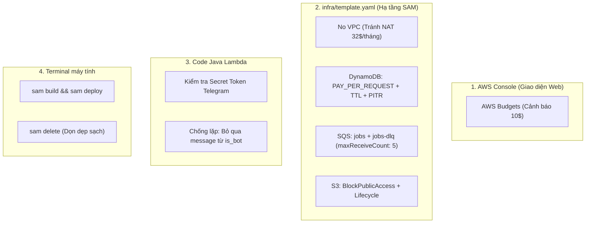

# TỔNG HỢP KIẾN THỨC & HƯỚNG DẪN THỰC THI TASK 1: BỘ KHUNG HẠ TẦNG AWS SAM (BE-03)

---

## MỤC LỤC
1. [Quy tắc đặt tên nhánh (Branch) và Commit trong dự án](#1-quy-tắc-đặt-tên-nhánh-branch-và-commit)
2. [Đánh giá hiện trạng Task 1 (BE-03)](#2-đánh-giá-hiện-trạng-task-1-be-03)
3. [Bản chất & Lý thuyết cốt lõi (Tại sao & Cần biết gì)](#3-bản-chất--lý-thuyết-cốt-lõi)
4. [Các cảnh báo sống còn khi deploy trên AWS (Chi phí & Mạng)](#4-các-cảnh-báo-sống-còn-khi-deploy-trên-aws)
5. [Làm ở đâu và Tại sao lại làm ở đó? (Phân nhóm cấu hình)](#5-làm-ở-đâu-và-tại-sao-lại-làm-ở-đó)
6. [Hướng dẫn thực thi chi tiết từng bước (Code mẫu & Lệnh)](#6-hướng-dẫn-thực-thi-chi-tiết-từng-bước)

---

## 1. QUY TẮC ĐẶT TÊN NHÁNH (BRANCH) VÀ COMMIT

### Vị trí quy định trong tài liệu
* **README.md** (Dòng 32–43 – Mục *Quy ước làm việc*).
* **docs/implementation-plan.md** (Mục 10 – *Cách làm việc > Git*).
* **CHANGELOG.md** (Dòng 3 – dẫn chiếu chuẩn *Conventional Commits*).
* **.github/pull_request_template.md** (Checklist tạo PR).

### Tóm tắt quy tắc
* **Tên nhánh (Branch):** 
  * Cú pháp: `<loại>/<MÃ_TASK>-<mô-tả-ngắn>`
  * Ví dụ: `feat/BE-22-webhook`, `feat/BE2/sh-01`, `feat/BE-03-sam-skeleton`
  * Quy tắc: Nhánh ngắn, PR nhỏ (≤ 400 dòng), không bao giờ push trực tiếp vào `main`.
* **Commit message & Tên PR:**
  * Tuân theo chuẩn **Conventional Commits**: `feat:`, `fix:`, `test:`, `docs:`, `chore:`.
  * Luôn kèm mã task: `feat(contracts): chốt hợp đồng BE↔AI (SH-01)`.
  * Không đặt tên trơn chỉ có mã số (tránh đặt mỗi `SH-02`).
  * Body PR ghi `Closes #<số issue>` để liên kết và tự đóng issue trên GitHub Board.
  * Cập nhật `CHANGELOG.md` với các thay đổi nhìn thấy được.
  * **Tuyệt đối không commit secret** (`.env`, bot token, AWS access key).

---

## 2. ĐÁNH GIÁ HIỆN TRẠNG TASK 1 (BE-03)

### Bối cảnh & Yêu cầu Task 1
* **Mục tiêu:** Tạo bộ khung hạ tầng đám mây đầu tiên cho dự án Ask-First chạy trên môi trường `dev` của AWS bằng 1 lệnh duy nhất (`sam deploy`). Giúp 2 bạn BE (BE1 và BE2) làm quen với AWS SAM từ tuần 1, biết cách tự deploy và rollback.
* **Người làm:** BE2 chính (DynamoDB, S3, SSM), BE1 (Webhook, SQS). Pair programming.

### Bảng đối soát hiện trạng
| Hạng mục yêu cầu | Hiện trạng mã nguồn | Đánh giá |
| :--- | :--- | :---: |
| **AWS SAM Template (`infra/template.yaml`)** | Thư mục `infra/` chỉ có file rỗng `.gitkeep`. Không có `template.yaml`. | ❌ Chưa có |
| **Lambda Webhook Hello World (Function URL)** | Đã có code trong `backend/ScamProtection/webhook-handler`, nhưng viết cho API Gateway/LocalStack; chưa cấu hình Function URL trong SAM. | ⚠️ Chưa đúng trọng tâm |
| **DynamoDB `askfirst`** | Chưa có bảng single-table với PK/SK, GSI1, TTL, PITR. | ❌ Chưa có |
| **SQS `jobs` + `jobs-dlq`** | Mới tạo `webhookQueue` bằng bash script trên LocalStack; chưa khai báo SAM. | ❌ Chưa có |
| **S3 Bucket** | Chưa có bucket chặn public, chia 3 prefix (`models/`, `kb/`, `donated/`) và lifecycle. | ❌ Chưa có |
| **SSM Parameter Store** | Chưa khai báo tham số dev trong SAM template. | ❌ Chưa có |
| **Tài liệu `infra/README.md`** | Chưa tồn tại trong thư mục `infra/`. | ❌ Chưa có |

> [!IMPORTANT]
> **Kết luận:** Task 1 **CHƯA HOÀN THÀNH**. Team đã làm tốt bước giả lập LocalStack, nhưng mục tiêu của Task 1 là làm quen với **AWS SAM thật** trên môi trường AWS Dev.

---

## 3. BẢN CHẤT & LÝ THUYẾT CỐT LÕI

| Khái niệm | Bản chất | Tại sao dự án Ask-First cần dùng? |
| :--- | :--- | :--- |
| **AWS SAM (IaC)** | Viết hạ tầng thành file code YAML (`template.yaml`). | Giúp cả team deploy môi trường giống hệt nhau bằng 1 lệnh `sam deploy`. Xóa sạch chỉ bằng `sam delete`, không lo bị sót tài nguyên tốn tiền. |
| **Lambda Webhook (Hello World)** | Hàm chạy không cần máy chủ, kèm Function URL. | "Thông đường truyền" (tracer bullet): đảm bảo Telegram gọi vào được và nhận 200 OK trước khi viết logic phức tạp. |
| **SQS `jobs`** | Hàng đợi tin nhắn bất đồng bộ. | Đệm tin nhắn người dùng gửi đến, tránh việc xử lý AI lâu làm Telegram báo timeout. |
| **SQS `jobs-dlq` (Dead Letter Queue)** | Hộp thư chết chứa tin nhắn lỗi. | Gom các tin nhắn bị lỗi xử lý quá 5 lần để không làm nghẽn hàng đợi chính. |
| **DynamoDB `askfirst`** | Cơ sở dữ liệu NoSQL tốc độ cao. | Lưu user, phiên kiểm tra lừa đảo. Có TTL tự xóa dữ liệu tạm và PITR tự backup. |
| **S3 Bucket** | Ổ cứng lưu trữ file trên mây. | Lưu file trọng số model, tri thức phòng ngừa (`kb/`), mẫu đóng góp (`donated/`). |
| **SSM Parameter Store** | Két lưu trữ cấu hình môi trường. | Quản lý cấu hình dev/prod tập trung, không hardcode vào Git. |

---

## 4. CÁC CẢNH BÁO SỐNG CÒN KHI DEPLOY TRÊN AWS

### 1. Bẫy NAT Gateway & VPC (Nguy hiểm nhất)
* **Bẫy chi phí:** Một NAT Gateway trong VPC tốn tối thiểu **~32 – 35 USD/tháng (~800.000 VNĐ)** dù không có bất kỳ request nào.
* **Quy tắc thiết kế của Ask-First (Quyết định D1):** **KHÔNG DÙNG VPC, KHÔNG NAT GATEWAY**. Lambda chạy ở chế độ Serverless công cộng (mặc định), tự do gọi Internet (Telegram, Bedrock, S3, DynamoDB) mà không tốn phí mạng.

### 2. Cài đặt AWS Budgets ngay lập tức
* Truy cập AWS Console ➔ Budgets: Tạo cảnh báo qua email ở 3 mốc: **10$, 25$, 50$** để nhận thông báo tức thì nếu có phát sinh chi phí ngoài ý muốn.

### 3. Vòng lặp vô tận (Infinite Loop)
* **Webhook Telegram:** Bot trả lời tin nhắn ➔ Telegram báo tin mới về webhook ➔ Bot lại trả lời.
  * *Khắc phục:* Trong code Java, nếu `message.from.is_bot == true` thì `return 200 OK` ngay lập tức.
* **SQS Retry:** Worker gặp lỗi unhandled exception sẽ bị retry mãi mãi.
  * *Khắc phục:* Bắt buộc gán `RedrivePolicy: maxReceiveCount: 5` để chuyển sang DLQ.

### 4. DynamoDB Billing Mode
* Luôn chọn `BillingMode: PAY_PER_REQUEST` (On-Demand: không truy vấn = 0đ). Tuyệt đối tránh `PROVISIONED` (tính tiền theo giờ liên tục).

### 5. Dọn dẹp tài nguyên
* Khi không làm việc hoặc kết thúc đợt test: Chạy `sam delete --stack-name askfirst-dev` trên terminal.

---

## 5. LÀM Ở ĐÂU VÀ TẠI SAO LẠI LÀM Ở ĐÓ?



1. **Trên AWS Console:**
   * *Làm gì:* Tạo AWS Budget 10$.
   * *Tại sao:* Thuộc cấp độ tài khoản (Account level). Nếu viết vào code SAM, khi xóa stack dev thì cảnh báo bảo vệ thẻ ngân hàng cũng bị xóa theo.
2. **Trong file `infra/template.yaml`:**
   * *Làm gì:* Khai báo toàn bộ cấu hình DynamoDB, SQS, S3, Lambda Webhook Function URL.
   * *Tại sao:* Đây là file thiết kế kiến trúc chuẩn (IaC). Toàn bộ team chỉ cần 1 file này để tạo ra môi trường giống hệt nhau.
3. **Trong code Java (`WebhookHandler.java`):**
   * *Làm gì:* Xác thực token Telegram, kiểm tra `is_bot`.
   * *Tại sao:* SAM chỉ cấp đường truyền; chỉ có code Java mới phân tích được nội dung tin nhắn để phòng chống spam.
4. **Tại Terminal máy tính:**
   * *Làm gì:* Chạy lệnh `sam build`, `sam deploy`, `sam delete`.
   * *Tại sao:* Dùng SAM CLI để điều khiển và đồng bộ hạ tầng từ xa lên AWS.

---

## 6. HƯỚNG DẪN THỰC THI CHI TIẾT TỪNG BƯỚC

### Bước 1: Tạo code Lambda Hello World (Java 21)
Tạo class xử lý đơn giản tại `backend/ScamProtection/webhook-handler/src/main/java/com/askfirst/webhookhandler/HelloWebhookHandler.java`:

```java
package com.askfirst.webhookhandler;

import com.amazonaws.services.lambda.runtime.Context;
import com.amazonaws.services.lambda.runtime.RequestHandler;
import java.util.HashMap;
import java.util.Map;

public class HelloWebhookHandler implements RequestHandler<Map<String, Object>, Map<String, Object>> {
    @Override
    public Map<String, Object> handleRequest(Map<String, Object> input, Context context) {
        Map<String, Object> response = new HashMap<>();
        response.put("statusCode", 200);
        response.put("body", "{\"message\": \"Hello from AskFirst Webhook!\"}");
        
        Map<String, String> headers = new HashMap<>();
        headers.put("Content-Type", "application/json");
        response.put("headers", headers);
        return response;
    }
}
```

### Bước 2: Tạo file `infra/template.yaml`
Nội dung hoàn chỉnh đáp ứng đầy đủ tiêu chí của Task 1:

```yaml
AWSTemplateFormatVersion: '2010-09-09'
Transform: AWS::Serverless-2016-10-31
Description: AskFirst MVP Cloud Infrastructure (Dev)

Parameters:
  Stage:
    Type: String
    Default: dev
    Description: Environment stage (dev/prod)

Globals:
  Function:
    Timeout: 30
    MemorySize: 512
    Runtime: java21

Resources:
  # 1. LAMBDA WEBHOOK (FUNCTION URL)
  WebhookFunction:
    Type: AWS::Serverless::Function
    Properties:
      FunctionName: !Sub askfirst-${Stage}-webhook
      CodeUri: ../backend/ScamProtection/webhook-handler/
      Handler: com.askfirst.webhookhandler.HelloWebhookHandler::handleRequest
      FunctionUrlConfig:
        AuthType: NONE

  # 2. DYNAMODB ASKFIRST (SINGLE TABLE)
  AskFirstTable:
    Type: AWS::DynamoDB::Table
    Properties:
      TableName: !Sub askfirst-${Stage}
      BillingMode: PAY_PER_REQUEST
      AttributeDefinitions:
        - AttributeName: pk
          AttributeType: S
        - AttributeName: sk
          AttributeType: S
        - AttributeName: gsi1pk
          AttributeType: S
        - AttributeName: gsi1sk
          AttributeType: S
      KeySchema:
        - AttributeName: pk
          KeyType: HASH
        - AttributeName: sk
          KeyType: RANGE
      GlobalSecondaryIndexes:
        - IndexName: GSI1
          KeySchema:
            - AttributeName: gsi1pk
              KeyType: HASH
            - AttributeName: gsi1sk
              KeyType: RANGE
          Projection:
            ProjectionType: ALL
      TimeToLiveSpecification:
        AttributeName: ttl
        Enabled: true
      PointInTimeRecoverySpecification:
        PointInTimeRecoveryEnabled: true

  # 3. SQS QUEUES (jobs + jobs-dlq)
  JobsDeadLetterQueue:
    Type: AWS::SQS::Queue
    Properties:
      QueueName: !Sub askfirst-${Stage}-jobs-dlq
      MessageRetentionPeriod: 1209600

  JobsQueue:
    Type: AWS::SQS::Queue
    Properties:
      QueueName: !Sub askfirst-${Stage}-jobs
      VisibilityTimeout: 720
      RedrivePolicy:
        deadLetterTargetArn: !GetAtt JobsDeadLetterQueue.Arn
        maxReceiveCount: 5

  # 4. S3 BUCKET
  DataBucket:
    Type: AWS::S3::Bucket
    Properties:
      BucketName: !Sub askfirst-${Stage}-data-${AWS::AccountId}
      PublicAccessBlockConfiguration:
        BlockPublicAcls: true
        BlockPublicPolicy: true
        IgnorePublicAcls: true
        RestrictPublicBuckets: true
      LifecycleConfiguration:
        Rules:
          - Id: ExpireDonatedSamplesAfter90Days
            Status: Enabled
            Prefix: donated/
            ExpirationInDays: 90

  # 5. SSM PARAMETER STORE
  StageParam:
    Type: AWS::SSM::Parameter
    Properties:
      Name: !Sub /askfirst/${Stage}/config/stage
      Type: String
      Value: !Ref Stage

Outputs:
  WebhookFunctionUrl:
    Description: Function URL for Webhook
    Value: !GetAtt WebhookFunctionUrl.FunctionUrl
  DynamoDBTableName:
    Value: !Ref AskFirstTable
  JobsQueueUrl:
    Value: !Ref JobsQueue
  JobsDlqUrl:
    Value: !Ref JobsDeadLetterQueue
  S3BucketName:
    Value: !Ref DataBucket
```

### Bước 3: Lệnh Build & Deploy
Mở PowerShell tại thư mục dự án:
```powershell
cd infra
sam build
sam deploy --guided
```
*(Lần đầu chọn Stack Name: `askfirst-dev`, Region: `ap-southeast-1`, đồng ý tạo IAM role và Public Function URL).*

### Bước 4: Kiểm tra nghiệm thu ("Xong khi")
```powershell
# 1. Test Webhook
curl -X POST https://<url-nhan-duoc-tu-output>.on.aws/

# 2. Kiểm tra DynamoDB GSI1, TTL, PITR
aws dynamodb describe-table --table-name askfirst-dev
aws dynamodb describe-continuous-backups --table-name askfirst-dev

# 3. Tạo 3 prefix cho S3
aws s3api put-object --bucket askfirst-dev-data-<account_id> --key models/
aws s3api put-object --bucket askfirst-dev-data-<account_id> --key kb/
aws s3api put-object --bucket askfirst-dev-data-<account_id> --key donated/

# 4. Dọn dẹp sạch khi xong buổi thực hành
sam delete --stack-name askfirst-dev
```
